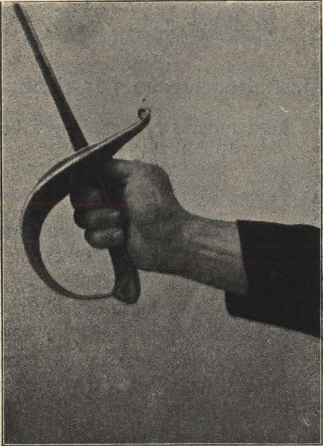

# Sabre Fencing (*Kardvívás*) — Introduction (*Bevezetés*), §§1–4

> Book pp. 1–2 · PDF pp. 13–14.
> Page markers like `[p. 2]` show where the printed page changes.

---

[p. 1]

## 1. The concept of sabre fencing (*A kardvívás fogalma*)

Sabre fencing is the art of handling the sabre consciously and effectively.

## 2. The aim of sabre fencing (*A kardvívás célja*)

The aim of sabre fencing is, on the one hand, to defend our bodily integrity against an attacker armed with a sword, and on the other, to render the opponent incapable of fighting. Fencing is not merely physical skill, nor is it merely knowledge, but the complete union of the two in an action that engages body and soul fully. The practice of fencing develops willpower, heightens the ability to notice and observe, and increases the speed of decision. So, on the one hand, it is suited to developing valuable qualities of mind, and on the other, it increases bodily strength and skill and makes the carriage and movements of the body light and easy.

## 3. The component parts of the fencing sabre (*A vívókard alkotó részei*)

The fencing sabre consists of the hilt (*markolat*) and the blade (*penge*). The basket (*kosár*) of the sabre also belongs to the hilt. On the blade we distinguish three parts:

- the part of the blade nearest the basket — the **strong** of the blade (*a penge erőse*), which we use only for carrying out parries;
- the middle part — the **middle** of the blade, which can be used for cutting and for parrying alike;
- and finally the third part — the **weak** of the blade and the point (*a penge gyengéje és hegye*), which is suited to cutting and thrusting.

The back of the weak of the blade we call the **back edge** (*fokél*); with it we can carry out a blade attack.

> **Translator's notes.**
> - *Markolat* is the whole hilt in §3 (it includes the basket), but in §4 it is the handle that is gripped. I translate it "hilt" in §3 and "grip" in §4.
> - *Fokél* is literally "back-edge" (*fok* = the back of a blade, *él* = edge). "Blade attack" is *pengetámadás*; the book treats these in Chapter IV (§§27–31), which is not yet translated.

## 4. The grip of the fencing sabre (*A vívókard fogása*)

The grip of the fencing sabre is as follows. The index finger and the thumb hold the base of the grip firmly in such a way that the former closes around the grip on its right side and, with its first joint, comes to face the thumb, which rests obliquely against the back of the grip. The front of the palm is set against the grip, so that the hollow of the palm [p. 2] remains empty; the middle, ring and little fingers, joining the index finger, hold the grip and press it firmly against the base of the palm.

*Fig. 1. The grip of the fencing sabre.* (*1. ábra. A vívókard fogása.*)

The grip of the sabre is correct only if we transfer our force to the following three points of the grip:

1. the one on which we press the first joint of our index finger,
2. the one on which the first joint of our thumb rests,
3. the one against which the front of the palm rests.

> **Translator's notes.**
> - *Első íz* ("first joint", or "first segment") is the only term the book uses for the finger parts. It does not say whether the count starts from the fingertip or from the hand. Fig. 1 shows the grip.
> - The text translated so far describes a right-handed fencer (right foot forward, left hand on the left hip). Fencing against a left-handed opponent has its own section (§64), not yet translated.
