# Sabre Fencing (*Kardvívás*) — First Part, Chapter I: In the basic stance (*Alapállásban*), §§5–12

> Book pp. 3–13 · PDF pp. 15–25 (PDF page = book page + 12).
> Page markers like `[p. 4]` show where the printed page changes. Figure captions give the book page the figure is printed on.
> Terms are explained in the [glossary](../glossary.md).

---

[p. 3]

**FIRST PART — INDIVIDUAL TRAINING** (*Első rész — Egyes kiképzés*)

**CHAPTER I — IN THE BASIC STANCE** (*I. fejezet — Alapállásban*)

## 5. The basic stance (*Alapállás*)

In the basic stance the heels touch, the feet form a 90° angle, and the toe of the right foot is pointed straight toward the imaginary opponent. The body stands in a natural, upright carriage, "half-left" (*fél bal*): the left shoulder is turned back, the right hip is drawn in a little, and the left hand is placed on the left hip. We hold the sabre with the regular grip, the edge turned to the right, the arm extended, at shoulder height, horizontally, the point forward. The sabre forms an obtuse angle with the extended arm.

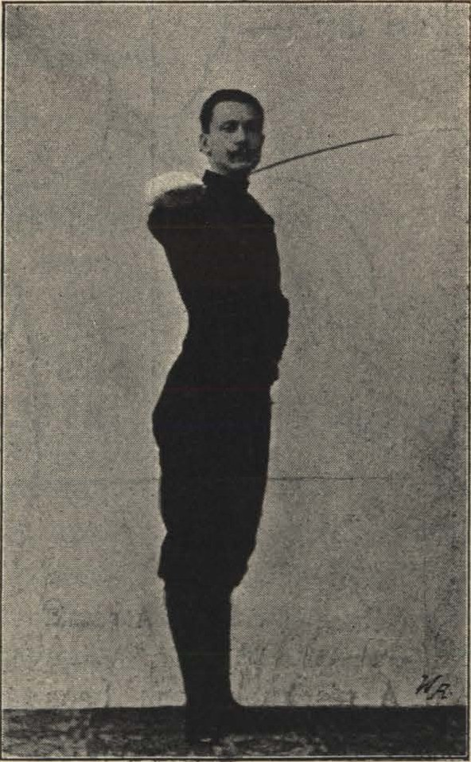

*Fig. 2. Basic stance* (*2. ábra. Alapállás*) — book p. 3

> **Translator's note.** *Fél bal* is the drill term "half-left" (in drill, a turn of roughly 45° to the left). The text gives no angle for the body; it says only that the left shoulder is turned back and the right hip drawn in.

## 6. Sabre attitudes (*Kardhelyzetek*)

Starting from the basic stance, we rotate the arm, extended horizontally forward, about its own axis so that in the **1st** sabre attitude the edge of the blade turns upward (the obtuse angle remains, so the point of the sabre goes slightly down); the **2nd** sabre attitude is identical with the basic stance; in the **3rd** attitude the edge of the blade faces downward (the point of the sabre is directed slightly upward); in the **4th** attitude the edge of the blade turns fully to the left (the blade [p. 4] is horizontal, its point slightly to the right); in the **5th** attitude the sabre is between the 3rd and 4th attitudes; and in the **6th** attitude, between the 2nd and 3rd.

> **Translator's notes.**
> - *Kardhelyzet* ("sabre attitude", numbered 1–6) and *kardállás* ("sabre position", named tierce, seconde, etc., see §11) are two different things in the book, so they get two different English words. An attitude is the roll of the arm and blade about the arm's axis; a position (§11) is where the hand and point are held.
> - Restated as a table (from the text above, nothing added):
>
> | Attitude | Edge of the blade faces | Other detail given |
> |---|---|---|
> | 1st | up | point goes slightly down (obtuse angle kept) |
> | 2nd | right | identical with the basic stance |
> | 3rd | down | point directed slightly up |
> | 4th | fully left | blade horizontal, point slightly to the right |
> | 5th | between 3rd and 4th (down-left) | — |
> | 6th | between 2nd and 3rd (right-down) | — |

## 7. The at-ease stance (*Pihenő állás*)

On the command "At ease!" (*Pihenj!*) we lower the arm together with the sabre so far that its point touches the ground in front of the right foot; the left hand and the right foot may leave their places, and the fencer settles into a comfortable stance.

## 8. The fencing line (*A vívóvonal*)

By the term "fencing line" (*vívóvonal*) we mean the area between the opponents. Its lateral boundary is the straight line connecting the corresponding shoulders of the fencers; upward it extends to the head, downward to the ground. If we hold the point of our sabre at shoulder height and within the fencing line, we say that it is in the **middle line** (*középvonal*); below this, in the **low line** (*alsó vonal*); above this, in the **high line** (*felső vonal*).

> **Translator's note.** The text says "the straight line" (singular) for the lateral boundary. It presumably means the two lines joining the right shoulder to the right shoulder and the left to the left, which would make the fencing line a corridor between the fencers. Expressions such as "outside the line" (*a vonalon kívül*, §11) and "out of the line" (*a vonalból kijebb*, §12) would then mean beyond the side of that corridor.

## 9. The openings (*A rések*)

According to the rules of chivalry, in sabre fencing the part of the opponent's body above the hip — that is, the upper body, the arm, the hand and the head — forms the object of attack; these we call *openings* (*rések*). The openings are delimited according to the following drawing, with reference to the opponent's right arm.

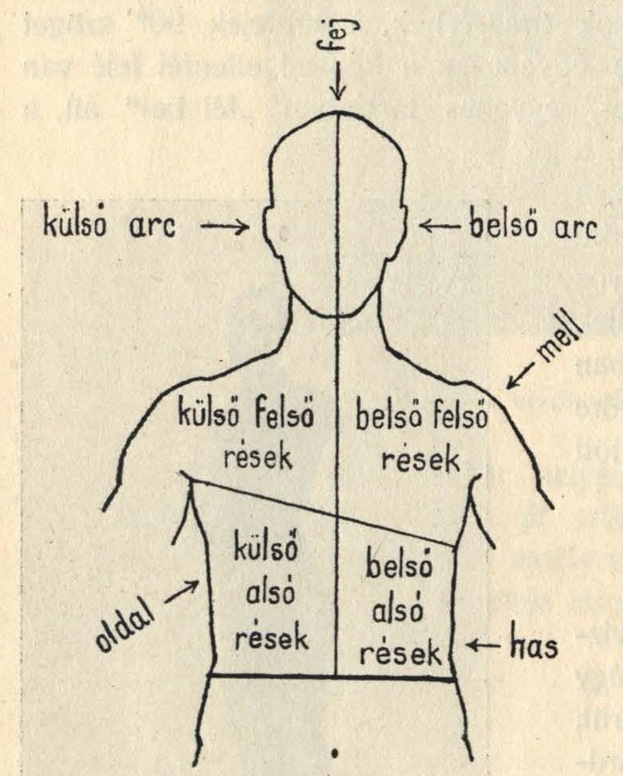

*Fig. 3. The openings* (*3. ábra. A rések*) — book p. 4

Labels on the drawing:

| On the drawing | English |
|---|---|
| fej | head |
| külső arc | outer face |
| belső arc | inner face |
| mell | chest |
| oldal | side |
| has | belly |
| külső felső rések | outer upper openings |
| belső felső rések | inner upper openings |
| külső alsó rések | outer lower openings |
| belső alsó rések | inner lower openings |

Within this division, the openings can also be defined more closely according to the body parts threatened, namely:

- **Outer upper openings** (*külső felső rések*): head, outer face, outer upper arm and hand;
- **Outer lower openings** (*külső alsó rések*): side, lower arm and hand underneath;
- **Inner upper openings** (*belső felső rések*): head, inner face, chest, arm and hand on the inside;
- **Inner lower openings** (*belső alsó rések*): chest and belly.

> **Translator's notes.**
> - The drawing is a front view of the upper body and head. The outer openings are on its left, the inner on its right, the upper ones above a slanting line across the torso and the lower ones below it, down to a horizontal line at the hips. The text says only that the division is made "with reference to the opponent's right arm"; if the picture is read as a front view of the opponent, the outer side is the side of that arm.
> - The chest (*mell*) appears in two of the lists: with the inner upper openings and with the inner lower openings. This is as printed.
> - "Rules of chivalry" (*a lovagiasság szabályai*): the book limits fencing to targets above the hip.

[p. 5]

## 10. Sabre swings (*Kardlendítések*)

By practising the sabre swings we prepare the pupils for cuts and parries. Diligent practice of them also develops the arm muscles and makes the fencer's movements surer. Preliminary practice of them is therefore highly necessary.

During a swing we guide the sabre by moving the forearm from the elbow and turning the upper arm from the shoulder, without the wrist making any considerable movement. Apart from the muscles needed to hold the sabre firmly, the others need not be tensed, and only in bringing the sabre forward do they come into play more, to speed up the movement and also to stop the swing.

In the sabre swings, when the sabre is brought back, the elbow bends fully, and the point of the sabre goes behind the body for a time, so that it can be swung forward from there.

We distinguish two kinds of sabre swing:

- a) the **circular swing** (*körszerű lendítés*);
- b) the **short swing** (*rövid lendítés*) (*kupé*).

### a) Circular swings (*Körszerű lendítések*)

We carry out the circular swings in a large arc. They are:

| Inner (*belső*) | Outer (*külső*) |
|---|---|
| swing to the head | swing to the head |
| swing to the side | swing to the chest |
| swing to the face from the left | swing to the face from the right |

**Inner swing to the head** (*belső lendítés a fejre*). From the basic stance I first pass to the 1st sabre attitude; from there the forearm, lowering the point of the sabre, swings it out in a circular movement in front of the left hip, chest and face, so that the basket, alongside the extended arm, comes level with my right shoulder and the sabre, having come forward (edge forward), forms an obtuse angle with the arm.

**Outer swing to the head** (*külső lendítés a fejre*). Starting from the basic stance, I bring the sabre into the 4th sabre attitude; from there, bending the elbow and taking it back, I swing the sabre to the right and back, and from there in an upward-moving circular arc I bring it forward beside the right cheek, so that the basket and the extended arm come level with my right shoulder [p. 6] and the sabre, edge forward, forms an obtuse angle with the arm. This swing must be assisted by arching the body (*a test homorításával*).

**Inner swing to the side** (*belső lendítés az oldalba*). Starting from the basic stance, I swing the sabre with the forearm (raising its point toward myself), passing by the face, the left shoulder and the left hip, forward and up in an arc, so that afterwards the arm is extended, the upper edge of the basket is level with the shoulder, the edge is slanted up to the right, and the point of the sabre swung forward stands level with my right hip.

**Outer swing to the chest** (*külső lendítés a mellre*). Starting from the basic stance, my forearm raises the sabre to my right temple, so that the forearm forms an acute angle with the upper arm, the upper arm staying in a horizontal position; from there the forearm swings the sabre in an arc outward and forward in the direction of the chest, so that, having come forward, the extended arm forms an obtuse angle outward with the sabre; the basket is level with the right shoulder, the edge of the sabre is slanted down to the left; the swing must be assisted by arching the body.

**Inner swing to the face from the left** (*belső lendítés az arcra balról*). The execution of this swing is similar to the swing to the side, with the difference that I carry out the whole swing at the height of the face and the left shoulder, so that after the extension the basket of the sabre comes to chin height and the sabre stands horizontal with the edge turned to the right.

**Outer swing to the face from the right** (*külső lendítés az arcra jobbról*). The execution of this swing is similar to the swing to the chest, with the difference that I direct the forward swing of the sabre higher (to the face).

> **Translator's notes.**
> - *Kupé* in the list is the book's own name for the short swing (from French *coupé*, "cut"). It is not to be confused with the *angle cut* (*szögvágás (kupé)*, §26), which is a separate section.
> - *Homorítás* means arching the back (making it hollow). The text says the outer swings to the head and to the chest "must be assisted" by it but does not describe the movement further.
> - The names "inner" and "outer" describe the path of the swing, as the descriptions show: an inner swing travels across the body, in front of the left hip, chest and face, and an outer swing goes out to the right of the body.

### b) Short swings (*Rövid lendítések*)

In the short swings the sabre travels backward, and from there back forward along the same path. We distinguish:

- short swing to the head;
- short swing to the side;
- short swing to the face from the left.

**1. The short swing to the head** (*a fejre való rövid lendítés*). With the rising elbow [p. 7] and with the forearm bent back at an acute angle toward the right chin, starting from the 3rd sabre attitude we swing the sabre behind our back so that its point sinks to about the height of the middle of the left upper arm; from there we bring the sabre back to its original position along the same path, but with accelerating movement.

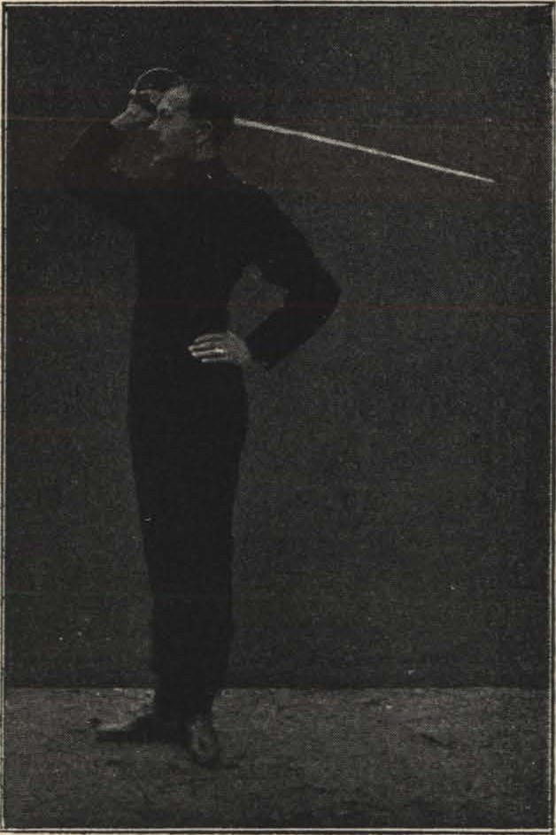

*Fig. 4. Short swing to the head, 1st movement* (*4. ábra. Rövid lendítés a fejre 1. mozdulat*) — book p. 6

**2. The short swing to the side** (*az oldalba való rövid lendítés*) is performed in a manner similar to the preceding one, but we start from the 2nd sabre attitude, and we perform the backswing so that the strong of the blade, directed toward the left hip, cuts obliquely across the middle of the upper body, and the elbow rises level with the shoulder; from there we swing the sabre straight forward into the imaginary opponent's side; the edge of the blade faces obliquely up to the right.

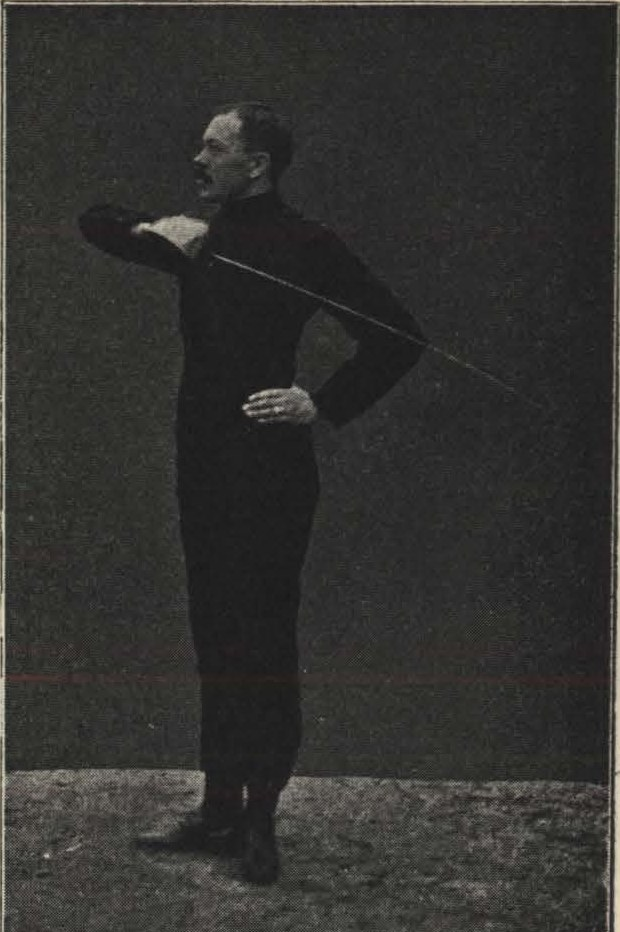

*Fig. 5. Short swing to the side, 1st movement* (*5. ábra. Rövid lendítés az oldalba 1-ső mozdulat*) — book p. 7

**3. For the short swing to the face from the left** (*az arcra balról való rövid lendítés*) we likewise start from the 2nd sabre attitude, and in carrying out the backswing we bend the forearm in, with the elbow, toward the left shoulder, so that shoulder, elbow and blade come into one and the same horizontal plane, and the point of the sabre goes backward; the forward swing is directed from the left to the face; the edge of the blade faces obliquely up to the right.

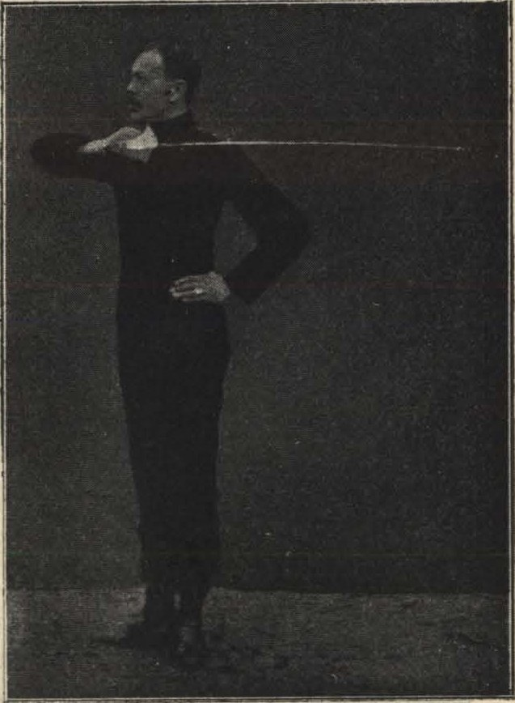

*Fig. 6. Short swing to the face from the left, 1st movement* (*6. ábra. Rövid lendítés az arcra balról 1-ső mozdulat*) — book p. 7

> **Translator's note.** The three photographs show only the first movement, the backswing, of each short swing. The book has no figures for the circular swings.

[p. 8]

## 11. Starting sabre positions (*Kiinduló kardállások*)

We teach the starting sabre positions first in the basic stance, but immediately afterwards we practise them in the fencing stance (see §13); the accompanying drawings were made accordingly.

**I. Tierce** (*Terc*). Starting from the basic stance, I take the basket of the sabre somewhat farther back by moderately bending the elbow, so that the hand and forearm are covered by the basket (this is attainable if we press the elbow downward); the sabre is in the 6th sabre attitude, and the point of the sabre is at the height of our right eye and in the line.

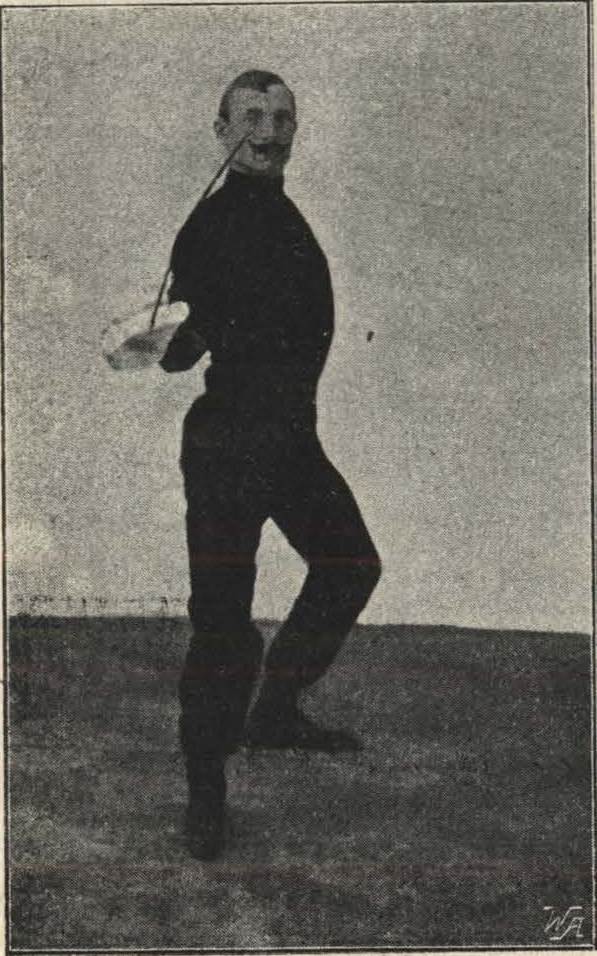

*Fig. 7. Tierce position* (*7. ábra. Terc-állás*) — book p. 8

**II. Seconde** (*Szekond*). Starting from the basic stance, the forearm brings the sabre back in a circular movement in front of the face and chest, and swings it on in an arc forward and to the right so far that the point of the sabre comes level with our right hip, in the low line, with its blade slanting up to the right, and the upper edge of the basket comes level with the right shoulder; the arm is moderately bent at the elbow.

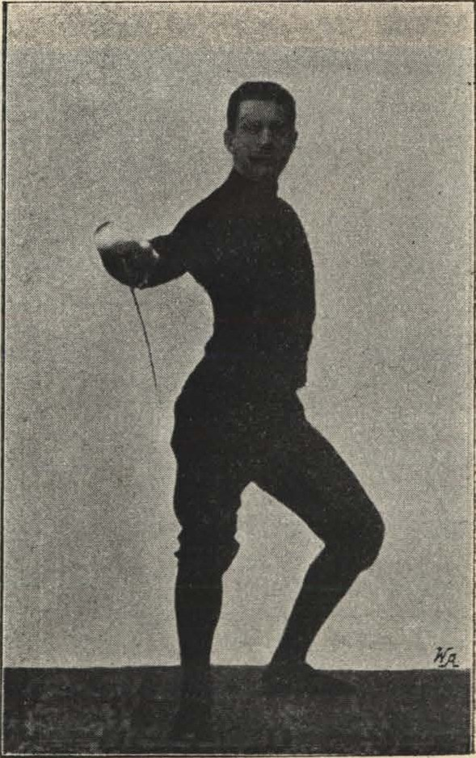

*Fig. 8. Seconde position* (*8. ábra. Szekond-állás*) — book p. 8

**III. Prime** (*Prím*). Starting from the basic stance, we bring our sabre in front of the chest with a movement similar to the seconde swing, but swing it forward and to the left, so that [p. 9] the point of the sabre, in the low line, is level with the left knee and the edge of the sabre faces obliquely left and up; the arm is moderately bent at the elbow, and the upper edge of the basket is at the height of the left shoulder.

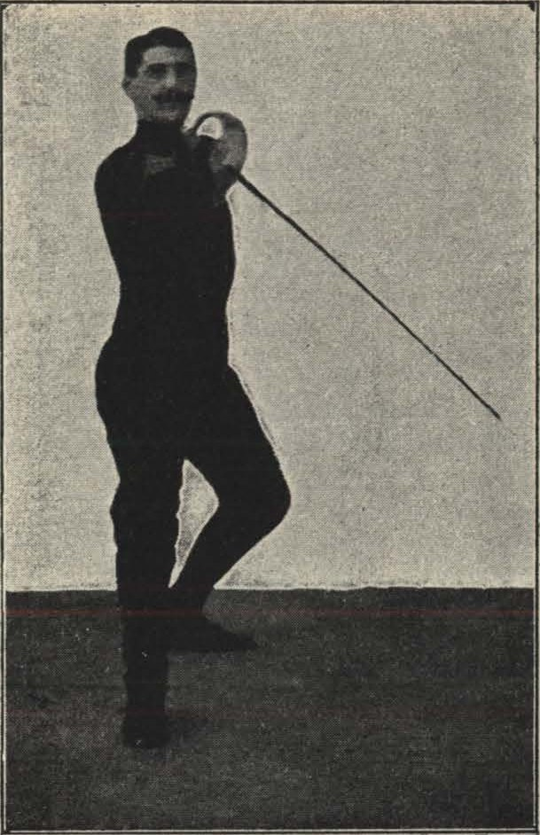

*Fig. 9. Prime position* (*9. ábra. Prim-állás*) — book p. 9

**IV. Quinte** (*Kvint*). Starting from the basic stance, we bring our sabre in front of the right cheek with a movement similar to the seconde swing, and from face height swing it forward and up, so that the basket comes in front of the right temple and the point of the sabre a little to the left of, and higher than, the left temple — so high that the inner face is not left uncovered; the arm is moderately bent at the elbow.

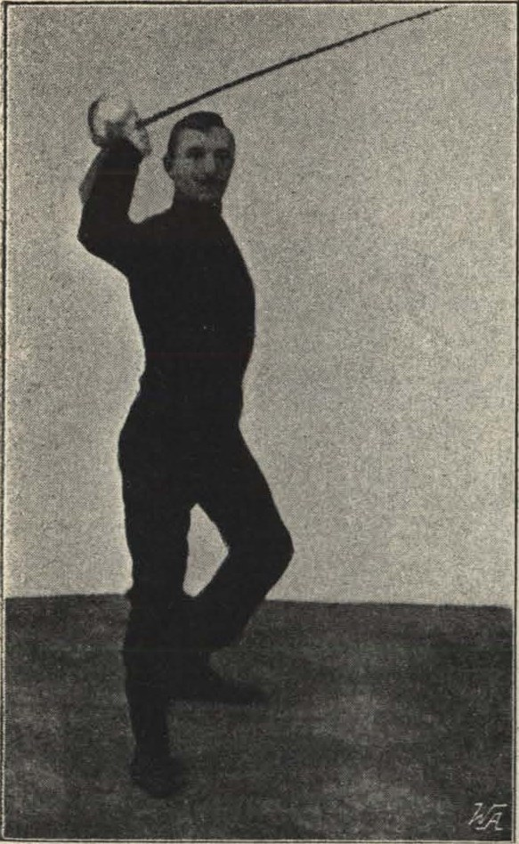

*Fig. 10. Quinte position* (*10. ábra. Kvint-állás*) — book p. 9

> **Translator's note — a doubtful phrase.** The printed words are *hogy a belső arc fedezve ne legyen*, literally "so that the inner face is **not** covered". That would contradict the purpose of the position: §12 says that after the quinte "the head" is protected. I have translated the evidently intended sense ("is not left uncovered"), as if the book had *fedezetlen ne legyen*. If the literal reading matters, check the last lines of the left-hand text column on book p. 9 (PDF p. 21).

**V. Quarte** (*Kvárt*). Starting from the basic stance, we draw the basket sharply (*rántjuk*) in front of the pit of our stomach (*gyomorgödör*) in such a way that the blade comes into the 5th attitude, the elbow sinks to the hip, the forearm stands horizontal, half-left (*félbalra*), and the point of the sabre stands to the left, outside the line, level with the left eye.

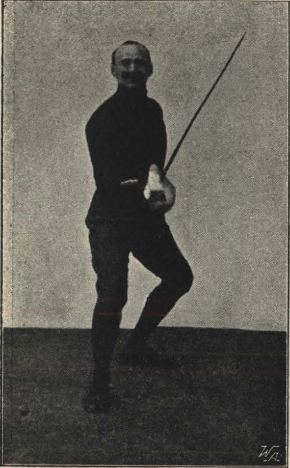

*Fig. 11. Quarte position* (*11. ábra. Kvárt-állás*) — book p. 10

**VI. Low tierce** (*Mélyterc*). I bend and lower the arm so far that the elbow rests on the right hip, the forearm is directed slightly downward, the lower edge of the basket comes to rest lower than the right hip, the edge of the sabre is turned [p. 10–11] outward, and the point of the sabre stands level with the right temple, outside the line.

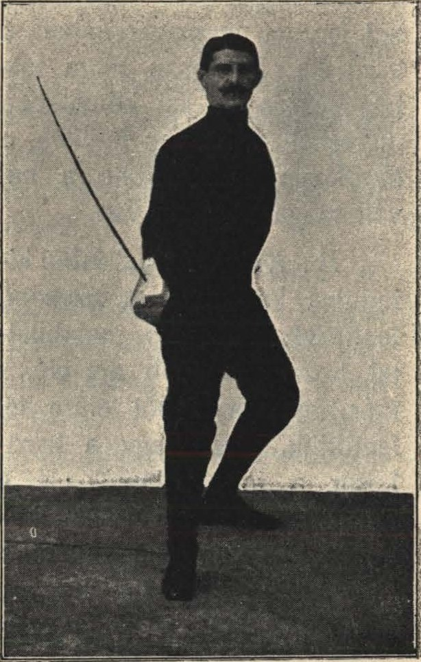

*Fig. 12. Low tierce position* (*12. ábra. Mélyterc-állás*) — book p. 10

> **Translator's note.** The sentence above runs across three pages: the printed page 10 holds only Figs. 11–14 (and no text), so `[p. 10–11]` marks the spot where the text stops on p. 9 and resumes on p. 11.

**VII. Low quarte** (*Mélykvárt*). The low quarte can be of two kinds, namely:

1. the one that protects the belly: the elbow pressed to the hip, the forearm directed to the left (backward) and downward, the edge of the sabre to the left and down, and its point outside the line, at eye height;
2. we jerk the bent arm down with a blow-like movement so that the strong of the blade — the sabre held horizontal, its point directed fully to the left and its edge turned downward — comes below the hip (thus, as regards the position of the sabre, the reverse of the quinte); it protects against low thrusts.

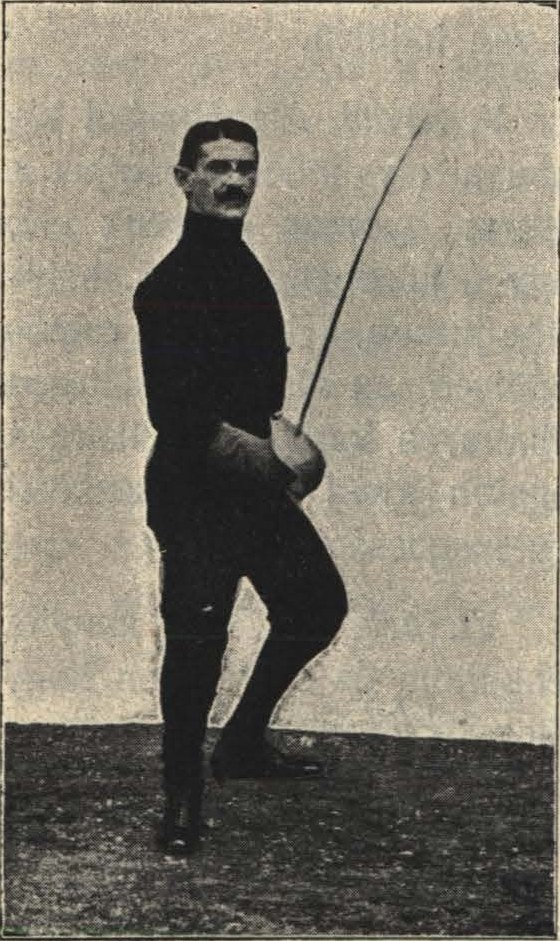

*Fig. 13. Low quarte (1) position* (*13. ábra. Mélykvárt (1) állás*) — book p. 10

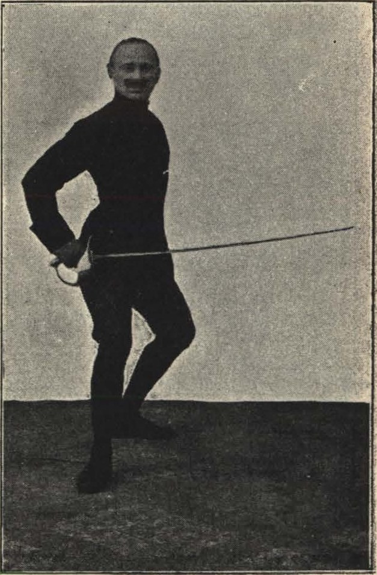

*Fig. 14. Low quarte (2) position* (*14. ábra. Mélykvárt (2) állás*) — book p. 10

**VIII. Sixte** (*Szext*). This sabre position arises from tierce in the following way: we raise the elbow toward our left shoulder so that at the same time the forearm stands vertical and the hand comes toward the left eye; in the process the point of the sabre rises backward in an arc and sinks to the right almost to the horizontal position, and the edge of the sabre faces upward.

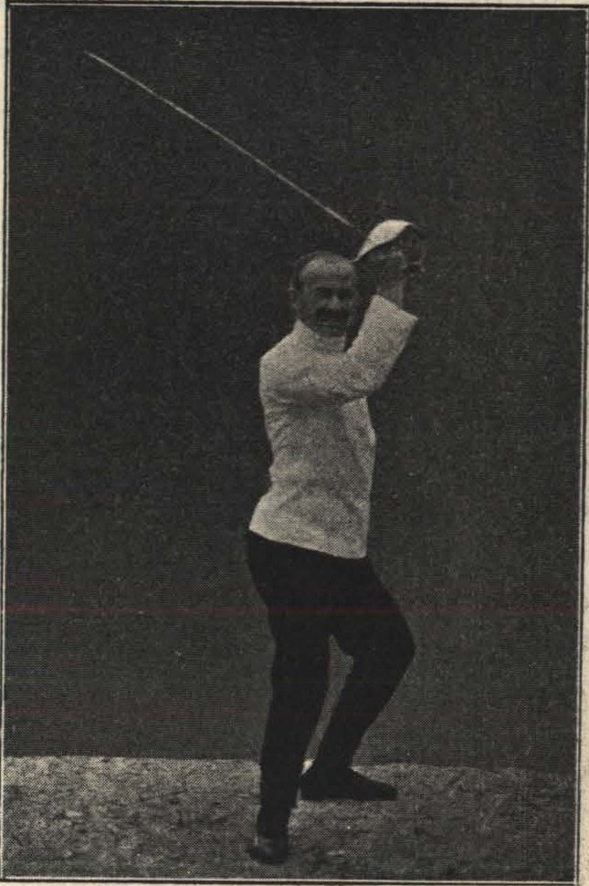

*Fig. 15. Sixte position* (*15. ábra. Szext-állás*) — book p. 11

**Septime** (*Szeptim*). We begin this yielding parry (*engedő hárítás*) exactly as the sixte, but in order to protect the outer upper openings as well, from the sixte position [p. 12] we carry the blade almost vertically downward, while holding our hand to the right of the right temple and at head height.

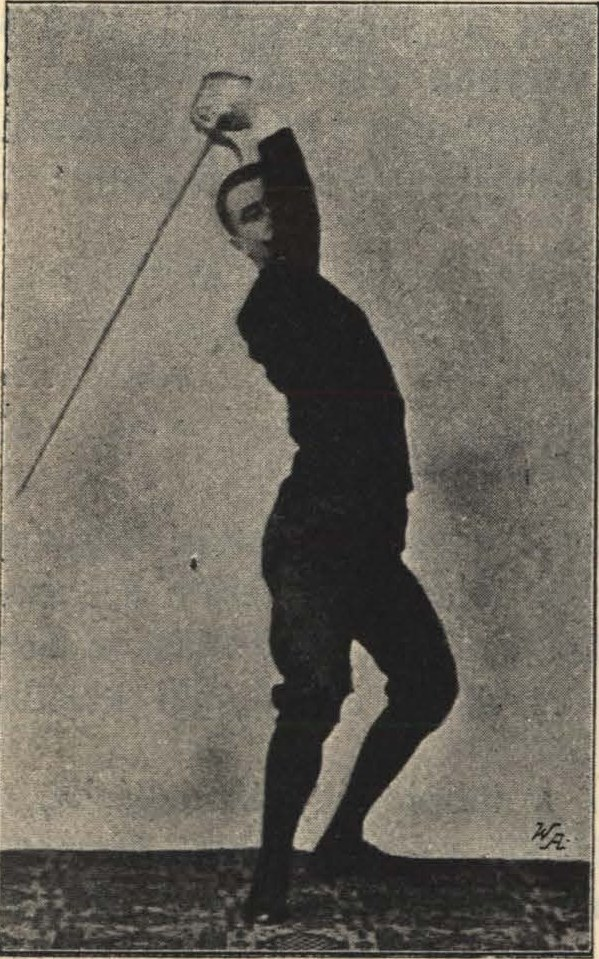

*Fig. 16. Septime position* (*16. ábra. Szeptim-állás*) — book p. 11

The sabre positions low tierce, low quarte 1 and 2, sixte and septime, as auxiliary parries (*kisegítő hárítás*), I have included here already, because they actually belong here; but, as the drawing also shows, we use them only in school fencing (*iskolavívás*) and later in free fencing (*szabad vívás*).

> **Translator's notes on §11.**
> - The book numbers the positions I–VIII (tierce, seconde, prime, quinte, quarte, low tierce, low quarte, sixte); septime has no numeral. Note that quinte (IV) comes before quarte (V) here.
> - "In the line" / "outside the line" refer to the fencing line of §8. "Low line" (*alsó vonal*) is the line below shoulder height.
> - *Mélykvárt* (VII) has two forms that the book calls (1) and (2); the figures are labelled the same way (Figs. 13, 14).
> - *Gyomorgödör* is the hollow below the breastbone (the pit of the stomach).
> - *Félbalra* is the drill term "half-left", here a direction for the forearm: horizontal, pointing diagonally to the left.
> - A table of the nine positions, with the openings each protects (§12), is in the [glossary](../glossary.md#the-sabre-positions-kardállások).

## 12. Parry swings (*Hárítási lendítések*)

These are nothing other than preparations for the parries and for the correct guiding of the sabre.

We also practise the parry swings at first without foot and body movements, and for carrying them out we make movements similar to those for taking up the starting "sabre positions" (§11), but we start from one of the sabre positions or from an invitation (§19). They become parry swings because the point of the sabre moves farther out of the line, so that it is able to ward off a cut or a thrust.

Accordingly, after the "tierce parry swing" our outer upper openings are protected; after "seconde", the outer lower ones; after "prime", the inner lower ones; after "quinte", the head; after "quarte", the inner upper openings; after "low tierce", the outer lower ones; after "low quarte" 1, the belly; after "low quarte" 2, we are protected against a low thrust; after "sixte", the head is protected; after "septime", the outer upper openings.

We distinguish three kinds of parry swing, namely:

- a) simple parry swings;
- b) counter-parry swings;
- c) half-counter-parry swings.

> **Translator's note — "invitation" (§19).** §12 refers forward to §19 (book p. 21, in Chapter III, not yet translated), which defines the *invitation* (*meghívás*, *invito*). Its text, translated: "In an invitation the holding of the sabre is the same as in the sabre positions, except that here the point of the blade stands outside the line, whereby we deliberately give our opponent an opportunity to attack. The invitations bear the same names as the sabre positions: tierce, seconde, prime, quarte and quinte invitation."

### A) Simple parry swings (*Egyszerű hárítási lendítések*)

From each sabre position we can carry out 4 simple parry swings one after another; for example, starting from "tierce", first into "seconde", then back along the same path, from "tierce" into prime and back, from "tierce" into "quarte" and back, from tierce into quinte and back.

Similarly from "seconde" into the other four sabre positions, and likewise from "prime", "quarte" and "quinte"; thus in all there are 5 × 4 = 20 parry swings.

Commands: "*Basic stance!*" "Tierce – *one!*" "Seconde – *one!*" "Quinte – *one!*" etc. "*Basic stance!*" "*At ease!*"

[p. 13]

### B) Counter-parry swings (*Ellenhárítási (contro) lendítések*)\*

Starting from any invitation (§19), the sabre returns by a circular arc into the same invitation. This arc is:

1. From tierce: outward and downward.
2. From seconde: up and inward.
3. From prime: up and outward.
4. From quarte: down and outward.
5. From quinte: down, and it starts toward myself.

Commands: "Counter-tierce – *one!*" or "Counter-seconde – *one!*" or "Counter-prime – *one!*" or "Counter-quarte – *one!*" or "Counter-quinte – *one!*"

> **Translator's note — misnumbering.** In the print the list above is numbered 1, **3**, 3, 4, 5 (the second item is printed "3."). It is renumbered 1–5 here.

### C) Half-counter-parry swings (*Fél-ellenhárítási lendítések*)

By half-counter-parry swings we mean a circular parrying movement in which we make half of the counter-parry movement, and from there go by the shortest path into another sabre position. They can be carried out:

| From | Into |
|---|---|
| tierce | quinte |
| tierce | prime |
| quarte | seconde |
| seconde | quarte |

Commands: "Half-counter-quinte – *one!*" "Half-counter-prime – *one!*" "Half-counter-seconde – *one!*" "Half-counter-quarte – *one!*"

---

\* A fuller explanation is given in §33. *(Footnote, book p. 13; §33 is not yet translated.)*

> **Translator's note.** In the half-counter-parry commands the name after "half-counter" is the position the sabre ends in (e.g. "Half-counter-quinte" is the tierce → quinte swing).
