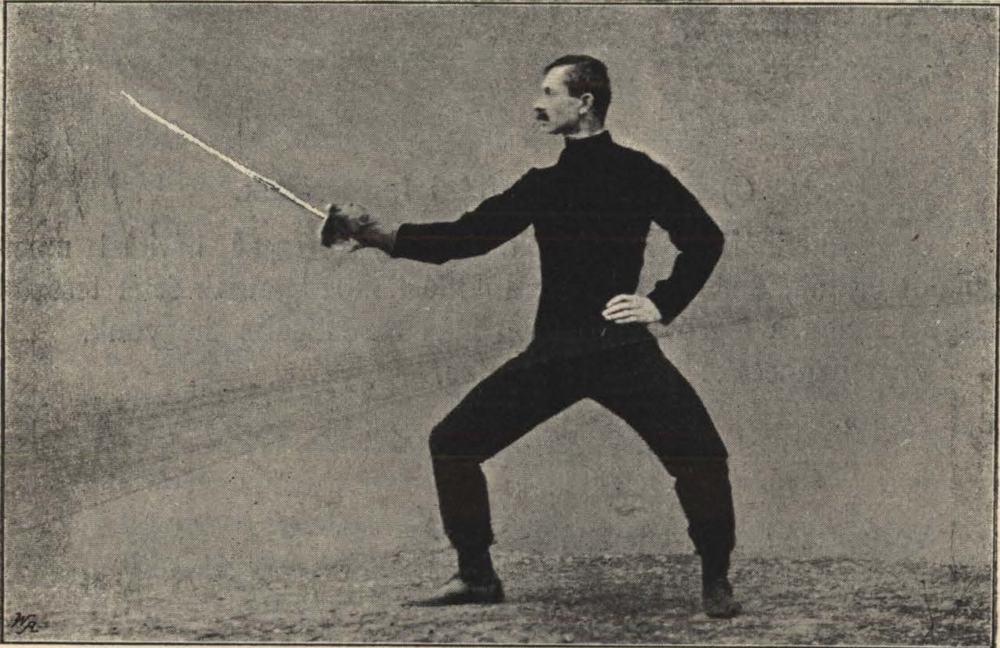

# Sabre Fencing (*Kardvívás*) — First Part, Chapter II: In the fencing stance (*Vívóállásban*), §§13–16

> Book pp. 14–19 · PDF pp. 26–31 (PDF page = book page + 12).
> Page markers like `[p. 15]` show where the printed page changes. Figure captions give the book page the figure is printed on.
> Terms are explained in the [glossary](../glossary.md).

---

[p. 14]

**CHAPTER II — IN THE FENCING STANCE** (*II. fejezet — Vívóállásban*)

## 13. The fencing stance (*Vívóállás*)

On the command "Fencing stance!" (*Vívni állás!*), starting from the basic stance, the fencer bends the legs at the knees so far that the knees come above the corresponding toes, then places the right foot about two foot-lengths straight forward and sets it on the ground with a light stamp of the heel, and the sabre comes into "tierce position". The weight of the body is distributed over both legs.

*Fig. 17. Tierce position, from the side* (*17. ábra. Tercállás oldalról*) — book p. 14

In the fencing stance we bend the left leg so far that the knee comes above the left toe, while the right lower leg stands vertical.

If a different sabre position had to be taken in the fencing stance, this is always done on a separate order, e.g. "seconde" "*Position!*", etc.

## 14. Foot and body movements (*Láb- és testmozdulatok*)

The various foot and body movements serve to enable the fencer to move forward or backward (and possibly sideways) in the fencing line. Practising them develops the muscles of the legs and upper body and, [p. 15] strengthening the beginner's stance, enables the beginner to carry out rounded movements — in other words, it teaches mastery over one's own body. The foot and body movements must not influence the prescribed movement of the sabre and the arm.

We carry out the foot and body movements starting from the fencing stance, and they can be the following.

**1. The "step forward"** (*előre lépés*) serves to approach our imaginary opponent. On the command "Forward – *one!*" we raise the toe of our right foot and swing the right lower leg forward, without raising the knee, so that the forward movement of the right foot by a foot-length takes place directly above the ground, and there it steps on the heel again; after it we take the left foot — and with it the weight of the upper body — forward. The upper body follows the movement of the feet in an unchanged position.

**2. The "step back"** (*hátra lépés*) serves to withdraw ourselves from the imaginary opponent. On the command "Back – *one!*", from the fencing stance we place the left foot a foot-length back, directly above the ground, and with it the weight of the body too; then, as though gripping with the left foot, we quickly bring the right foot back as well and stamp down on the whole sole. The upper body follows the movement of the feet in an unchanged position.

**3. The "lunge"** (*kitörés*) serves to reach our imaginary opponent with our sabre, starting from the fencing stance, by the shortest way and by surprise. On the command "Lunge – *one!*": the right arm is quickly extended forward (for its use see under *thrust*), and after the upper body has been bent forward from the hip, we swing our right leg quickly forward at the knee, directly above the ground, and — with the simultaneous extension of the left leg — set it down about a step forward in such a way that we step first on the heel. The lunge is correct if the right lower and upper leg form a right angle, the upper body is roughly in the extension of the outstretched left leg, and the left sole presses flat on the ground.

**4. Recovery from the lunge** (*kitörésből felállás*). This serves to withdraw ourselves after carrying out our attack and to put ourselves in readiness. On the command "*Position!*" (*Állás!*), by contracting the left leg and pushing off with the right leg we take the upper body back, and quickly set the right foot back at the place defined in the fencing stance; the body, however, must not rise above its height in the fencing stance.

**5. Lunge backward** (*kitörés hátra*). With this we can stop our imaginary opponent's attack during its execution (e.g. with a stop thrust, *föltartó szúrás*; *passatto sotto*).

[p. 16]

On the command "Lunge back – *one!*", from the fencing stance we achieve the above-mentioned lunge by stretching our left leg backward; at the start of the movement the whole weight of our body rests on the right leg. On the command "*Position!*" the fencing stance is resumed as with the ordinary "lunge", that is, the left foot stays in place.

**6. Jump forward** (*ugrás előre*). We use this in blade attacks (*pengetámadások*); it increases the force of the blow (and possibly disconcerts our opponent). On the command "Jump forward – *one!*", from the fencing stance, lifting our right foot for an instant and placing the weight of the body on the left foot, we push ourselves forward with our left foot, for a jump of about a step, and there first the heel of the right foot touches the ground, and then the left foot.

**7. Jump backward** (*ugrás hátra*). With this we can withdraw ourselves most quickly from any kind of attack. On the command "Jump back – *one!*", after bending our knees more deeply we throw ourselves up and well back with both feet at once; to increase the thrust, during the jump we swing the right lower leg toward the thigh, but at the end of the backward jump we must again come into the fencing stance.

**8. Double lunge** (*kettős kitörés*). With this, during our attack, we gain ground forward again if the opponent withdraws backward from our first attack; it can be used in the continuation of our attack. On the command "Double lunge – *one!*", from the fencing stance we first perform the ordinary lunge, then, by bringing the left foot closer to the right foot, we settle into the fencing stance, and finally we lunge again (forward) with our right foot. (*Radoppió.*)

After mastering the simple foot and body movements, they must be practised in combination, namely on the following commands:

9. "Forward and lunge – *one!*" (*Patinando*), then "*Position!*"
10. "Back and lunge – *one!*" "*Position!*"
11. "Back and lunge back – *one!*" "*Position!*"
12. "Jump forward and lunge – *one!*" (*Ballestra*) "*Position!*"
13. "Bend the knees deeply!"
14. "In the lunge, lean backward and forward!"

The last two foot and body movements occur during fencing, so they can be practised, but the above are the most important.

> **Translator's notes on §14.**
> - The book numbers the foot and body movements 1–14 (items 9–14 are the combined commands). Items 1–3 and 5–8 are each commanded with a word ending in "– one!"; the recovery (4) is commanded "Position!".
> - *Lábhossz* ("foot-length") is the length of the foot, used as a measure; *lépésnyire* is "about a step". The two foot-lengths of §13 and the foot-length of the step in §14 are the book's own units; no metric figures are given in the pages translated so far.
> - Italian terms are kept as printed: *patinando*, *ballestra*, *radoppió*, *passatto sotto* (modern Italian spellings: *pattinando*, *balestra*, *raddoppio*, *passata sotto*). Here the book itself equates *patinando* with "forward and lunge", *ballestra* with "jump forward and lunge" and *radoppió* with the double lunge.
> - In the combined commands, "Forward" and "Back" mean the step forward and the step back (items 1 and 2), as in "Forward and lunge", i.e. a step forward followed by a lunge.

## 15. Air cuts (*Levegővágások*)

These cuts are identical with the sabre swings described above; we note, however, that starting from any position (e.g. tierce or seconde position, etc.) we carry them out combined with a lunge, at the [p. 17] openings of our imaginary opponent (so in the names, the expressions "outer" and "inner" etc. refer to the imaginary opponent).

These are preliminary exercises for the real cuts, with enlarged movements, and they can be "circular-swung" and "short-swung" cuts. The following cuts occur:

Cut names used below: head cut (*fejvágás*), side cut (*oldalvágás*), outer-face cut (*külső arcvágás*), inner-face cut (*belső arcvágás*), chest cut (*mellvágás*), belly cut (*hasvágás*). In the tables, "circular" and "short" are the two kinds of swing of §10. The last column reproduces the book's braces: "to be carried out with the inner swing" (*belső lendítéssel hajtandó végre*) or "with the outer swing" (*külső lendítéssel hajtandó végre*).

### I. From tierce position (*Tercállásból*)

| No. | Cut | Swing | Carried out with |
|---|---|---|---|
| 1 | head cut | circular | inner swing |
| 2 | side cut | circular | inner swing |
| 3 | outer-face cut | circular | inner swing |
| 4 | inner-face cut | circular | outer swing |
| 5 | chest cut | circular | outer swing |
| 6 *(printed "5")* | belly cut | circular | outer swing |
| 7 | head cut | short | — |
| 8 | outer-face cut | short | — |
| 9 | side cut | short | — |

Commands for practising these: "Tierce *position!*" "With outer swing, head cut – *one!*" "*Position!*" "With short swing, outer-face cut – *one!*" "*Position!*" "Forward and with short swing, head cut – *one!*" "*Position!*" "*Basic stance!*" "*At ease!*" etc.

### II. From seconde position (*Szekondállásból*)

| No. | Cut | Swing | Carried out with |
|---|---|---|---|
| 1 | head cut | circular | inner swing |
| 2 | side cut | circular | inner swing |
| 3 | outer-face cut | circular | inner swing |
| 4 | inner-face cut | circular | outer swing |
| 5 | chest cut | circular | outer swing |
| 6 | belly cut | circular | outer swing |
| 7 | side cut | short | — |
| 8 | outer-face cut | short | — |

Commands for practising these: "Seconde *position!*" "With inner swing, head cut – *one!*" "Seconde *position!*" "Forward and with short swing, outer-face cut – *one!*" "Seconde *position!*" etc.

### III. From prime position (*Prímállásból*)

| No. | Cut | Swing | Carried out with |
|---|---|---|---|
| 1 | head cut | circular | inner swing |
| 2 | side cut | circular | inner swing |
| 3 | outer-face cut | circular | inner swing |
| 4 | inner-face cut | circular | outer swing |
| 5 | chest cut | circular | outer swing |
| 6 | belly cut | circular | outer swing |
| 7 [p. 18] | side cut | short | — |
| 8 | outer-face cut | short | — |

Commands for practising these: "Prime *position!*" "With inner swing, side cut – *one!*" "Prime *position!*" "Forward, with outer swing, chest cut – *one!*" "Prime *position!*" etc.

### IV. From quarte position (*Kvártállásból*)

| No. | Cut | Swing | Carried out with |
|---|---|---|---|
| 1 | outer-face cut | circular | inner swing |
| 2 | side cut | circular | inner swing |
| 3 | head cut | short | — |
| 4 | outer-face cut | short | — |
| 5 | inner-face cut | short | — |
| 6 | chest cut | short | — |
| 7 | belly cut | short | — |

Commands for practising these: "Quarte *position!*" "With inner swing, outer-face cut – *one!*" "Quarte *position!*" "Forward, with short swing, inner-face cut – *one!*" "Quarte *position!*" etc.

### V. From quinte position (*Kvintállásból*)

| No. | Cut | Swing | Carried out with |
|---|---|---|---|
| 1 | head cut | circular | inner swing |
| 2 | side cut | circular | inner swing |
| 3 | outer-face cut | circular | inner swing |
| 4 | inner-face cut | circular | outer swing |
| 5 | chest cut | circular | outer swing |
| 6 | belly cut | circular | outer swing |
| 7 | side cut | short | — |
| 8 | outer-face cut | short | — |

Commands for practising these: "Quinte *position!*" "With inner swing, side cut – *one!*" "Quinte *position!*" "Forward, with short swing, outer-face cut – *one!*" "Quinte *position!*" etc.

> **Translator's notes on §15.**
> - **Misprint.** In the tierce list the sixth item (belly cut) is printed "5." (the print reads 1, 2, 3, 4, 5, 5, 7, 8, 9). It is numbered 6 here.
> - **The braces.** In the print, a brace groups items 1–3 (head, side, outer-face) with "to be carried out with the inner swing", and a second brace groups items 4–6 (inner-face, chest, belly) with "to be carried out with the outer swing". The same grouping appears in the lists from seconde, prime and quinte, and the quarte list has one brace over its items 1–2 ("with inner swing"). The "Carried out with" column simply restates this. The short-swing items have no brace.
> - **An inconsistency in the examples.** The brace puts the head cut with the inner swing, but the example command for tierce is "With *outer* swing, head cut" (and for seconde, "With *inner* swing, head cut"). §10 has both an inner and an outer swing to the head, so the book seems to allow either; which one goes with which starting position is not spelled out beyond these examples.
> - **"Outer" and "inner" mean two things.** In *outer-face cut* and *inner-face cut* the words name the target on the imaginary opponent (§9). In *inner swing* and *outer swing* they name the path of the swing (§10). The book's tables pair the outer-face cut with the inner swing, and the inner-face cut with the outer swing.
> - "Forward" in the example commands is a step forward (§14, items 1 and 9), as in "Forward and lunge".

## 16. Parry swings combined with air cuts (*Hárítási lendítések levegővágásokkal összekötve*)

### A) Simple parry swings combined with air cuts

From any of tierce / seconde / prime / quarte / quinte position, **first** a parry swing into seconde / prime / quarte / quinte / tierce, **and after it** a cut at the head / side / chest / belly / outer face.

> The book prints this as three bracketed columns of alternatives (the position; the parry swing; the cut). The rows of the columns are not pairs. The inner-face cut is not in this list, though it is in B) and C) and in the example below.

[p. 19]

Example: "Tierce *position!*" "Seconde and\* head cut – *one!*" "*Position!*" "Seconde and side cut – *one!*" "*Position!*"\*\* "Seconde and chest cut – *one!*" "*Position!*" "Seconde and belly cut – *one!*" "*Position!*" "Seconde and outer-face cut – *one!*" "*Position!*" "Seconde and inner-face cut – *one!*" "*Position!*" etc.

### B) Counter-parry swings combined with air cuts

From any of tierce / seconde / prime / quarte / quinte **invitation**, **first** the counter-parry swing "counter-tierce" / "counter-seconde" / "counter-prime" / "counter-quarte" / "counter-quinte", **and after it** a cut at the head / side / chest / belly / outer face / inner face.

For practising them, the examples are to be composed in the same way as under A).

### C) Half-counter-parry swings combined with air cuts

| From the invitation | First the swing |
|---|---|
| tierce | "half-counter-quinte" |
| tierce | "half-counter-prime" |
| seconde | "half-counter-quarte" |
| quarte | "half-counter-seconde" |

**and after it** a cut at the head / side / chest / belly / outer face / inner face.

### The three combined

After practising those under A) to C), their combination can be practised on the following commands: "Tierce *position!*" "Back, seconde and head cut – *one!*" "Quinte *position!*" "Counter-quinte and side cut – *one!*" "Seconde *position!*" "Half-counter-quarte, back and head cut – *one!*" "Tierce *position!*" "*Basic stance!*" "*At ease!*"

---

\* The kind of swing need not be commanded here. *(Footnote, book p. 19.)*

\*\* By "Position" here, naturally, only "Tierce position" can be understood. *(Footnote, book p. 19.)*

> **Translator's notes on §16.**
> - In the example under A) the printed footnote marks fall where shown above: `*` after "Seconde and", `**` after the second "Position!".
> - "Back" in the last example commands ("Back, seconde and head cut") is the step back (§14, item 2).
> - The book's contents list this section as "Parry swings combined with air cuts", and Chapter II ends here, at the foot of book p. 19. Chapter III (school fencing in pairs, "master–pupil") begins on p. 20.
